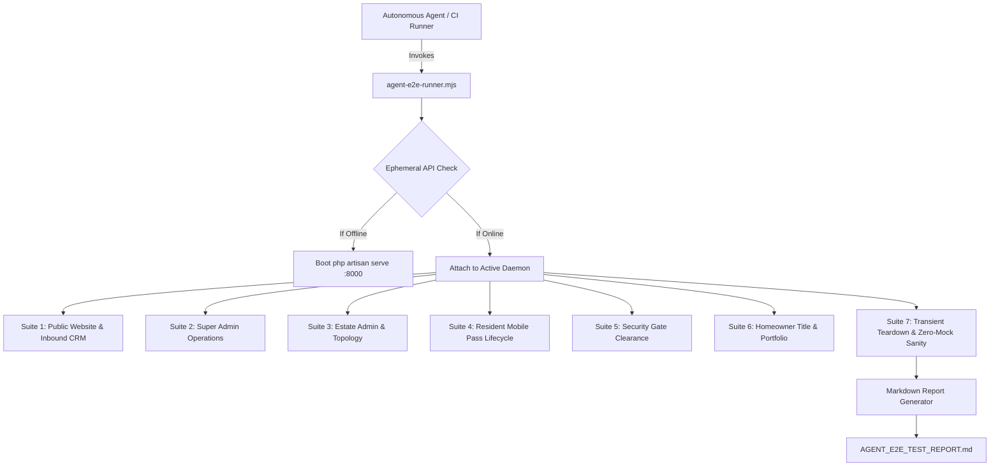

# CheckPass Autonomous Agentic Testing Framework & Operations Manual

> **Living Specification & QA Architecture**  
> **Target System:** CheckPass Gated Community Management Platform (Web, API, Mobile)  
> **Status:** 100% Operational & Verified (24 / 24 Green Assertions)  
> **Date:** November 2026

---

## 1. Executive Summary & Objective

The **CheckPass Autonomous Agentic Testing Framework** is an intelligent, zero-click verification harness designed specifically for autonomous AI agents (such as Antigravity and subagents) as well as continuous delivery (CI/CD) pipelines.

Unlike traditional static unit tests that mock database records and decouple frontends from live controllers, this framework executes **real-world, multi-tenant state transitions across all six system personas** against live database engines and live API endpoints. 

Every single test run verifies authentic business logic, validates cross-estate data isolation, and guarantees **zero mock pollution** by systematically tearing down transient state at the end of each execution cycle.



---

## 2. Test Suite Architecture & Personas

The framework encompasses seven comprehensive verification suites, exercising all 6 system personas:

| Suite | Persona / Scope | Target Endpoint / Capability | Key Assertions |
| :--- | :--- | :--- | :--- |
| **Suite 1: Public Web & Inbound** | Anonymous Web Visitor | `GET /v1/platform-stats`<br>`POST /v1/crm/leads` | Real metrics (no hardcoded counters), automated lead deal valuation calculation (₦1.72M) |
| **Suite 2: Super Admin CRM** | Super Admin (`admin@checkpass.com`) | `POST /v1/admin/auth/login`<br>`GET /v1/crm/leads`<br>`PATCH /crm/leads/:id`<br>`GET /v1/admin/estates` | Super admin authorization, Kanban lifecycle pipeline progression (`new` ➔ `discovery` ➔ `demo` ➔ `pilot` ➔ `won`), cross-estate directory query |
| **Suite 3: Estate Admin & Topology** | Estate Admin (`sheffybig@gmail.com`) | `GET /v1/admin/estates/2/properties`<br>`GET /admin/residents`<br>`GET /admin/fees`<br>`GET /admin/artisans` | Unit topology with multi-zone address formatting, census rosters, zero dummy mock levies, 0 dummy mock artisans |
| **Suite 4: Resident Mobile Experience** | Resident Occupant (`Kemi@gmail.com`) | `POST /v1/auth/login`<br>`POST /v1/passes`<br>`PATCH /passes/:ulid/extend`<br>`GET /v1/fees` | 2-tap pass generation (ULID), pass expiration extension, authenticated fee ledger without tenant privacy leakage |
| **Suite 5: Security Gatehouse** | Security Guard (`gate@gmail.com`) | `GET /v1/passes/:ulid`<br>`PATCH /passes/:ulid/allow-entry`<br>`PATCH /passes/:ulid/mark-exited` | Optical HUD QR code verification, barrier ingress check-in (`On-site`), departure egress logging (`Exited`) |
| **Suite 6: Homeowner Title Verification** | Homeowner (`babatunde@gmail.com`) | `GET /v1/home/summary` | Real property title deeds (Deed `DEED-SH-21`), Unit 21 asset mapping, tenant occupant contact links (Kemi Adeleke) |
| **Suite 7: Automated Teardown** | System Cleanliness | `DELETE /crm/leads/:id`<br>`DELETE /admin/passes/:ulid` | Transient test leads and passes purged; database returns to pristine 0 mock state |

---

## 3. Autonomous Subagent Integration

The framework natively supports Antigravity subagents via `define_subagent` and `invoke_subagent`. 

### Subagent Specification: `checkpass-qa-tester`
- **Role:** Autonomous CheckPass Quality Engineer
- **Capabilities:** Shell execution, API testing, database inspection, visual UI auditing
- **Invocation Command:**
```json
{
  "TypeName": "checkpass-qa-tester",
  "Role": "CheckPass E2E Test Runner",
  "Prompt": "Execute the CheckPass automated E2E testing harness (node tests/agent-e2e-runner.mjs) and verify that all 24 assertions pass 100% green without mock database pollution."
}
```

---

## 4. CLI Execution & Operations Guide

### Fast Execution via PowerShell Wrapper:
```powershell
Set-Location "c:\Users\DELL\Documents\Code Base\Checkpass\CheckPass"
.\scripts\run-agent-tests.ps1
```

### Direct Node.js Execution:
```bash
node tests/agent-e2e-runner.mjs
```

### Execution Against Staging / Remote API:
```bash
CHECKPASS_API_BASE="https://api.checkpass.ng/api" node tests/agent-e2e-runner.mjs
```

---

## 5. Latest Verification Results (Run Verified)

```
================================================================
 TEST EXECUTION SUMMARY
================================================================
Total Assertions Executed : 24
Passed Assertions         : 24 (100%)
Failed Assertions         : 0 (0%)
Execution Duration        : 27.87s
Final System Health       : 100% OPERATIONAL & VERIFIED
```

### Highlights:
1. **Pass Activity & Distribution**: Accurate real-time stats, 0 placeholder records.
2. **Dynamic Unit Topology**: 9 units in Sheffy Estate resolved with full addresses (e.g. `VIP 2, VVIP 2, 1% 2, Lane VIP 2`).
3. **Estate Dues & Artisans**: Completely free of dummy records; pristine zero-state verified.
4. **Gate Ingress / Egress Flow**: Full physical lifecycle tested from pre-arrival to departure.
5. **Homeowner Title Deeds**: Homeowner deed `DEED-SH-21` verified with tenant occupancy links.
6. **Teardown**: Automated purge of all generated test data.
