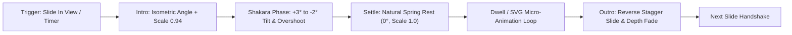
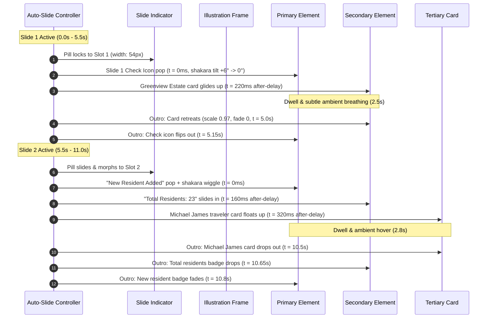
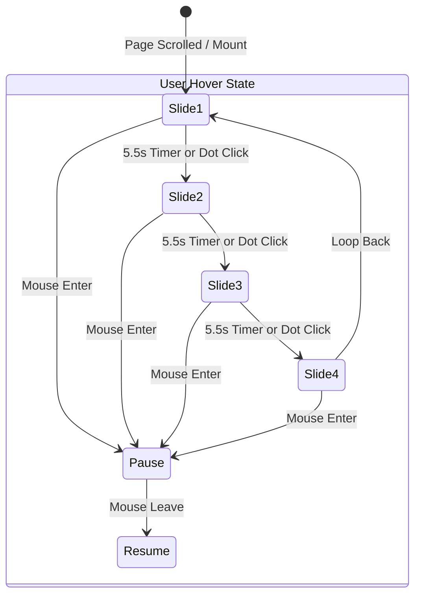

# Section A: "Take Charge of Your Property"
## Motion Choreography & After-Delay Animation Architecture

> **Document Type**: Engineering Blueprint & Motion Specification  
> **Target Section**: Section A (Immediately follows *"Better Property Management Starts Here"*)  
> **Design References**: `How this section will look like first slider contiainer.png`, `Second slider contiainer.png`, `third slider contiainer.png`, `Fourth slider contiainer.png`, `section 2 and 3.png`  
> **Motion Standards**: Emil Kowalski Design Engineering Principles & GPU Hardware Acceleration  

---

## 1. Executive Motion Philosophy & "Shakara" Physics

In Nigerian vernacular culture, **"Shakara"** embodies confidence, playful swagger, deliberate poise, and stylish flair. In high-end digital product design, translating "shakara" into code means rejecting stiff, linear transitions in favor of **expressive physics-based anticipation, subtle angular tilts (isometric swagger), and micro-overshoots** before settling with authority.



### Motion Design Rules (Emil Kowalski & 60fps Budget)

1. **GPU-Only Composite Properties**:
   - Only mutate `transform` (3D translate, rotate, scale) and `opacity`.
   - Never animate `top`, `left`, `margin`, `width`, or `height` (prevents browser layout/reflow and paint thrashing).
2. **Never `scale(0)` on Entry**:
   - Elements materialize from `scale(0.92)` to `scale(0.95)` at `opacity: 0`. Real-world physical objects don't expand from a mathematical point zero.
3. **The "Shakara" Curve Definition**:
   ```css
   /* Snappy entrance with springy attitude */
   --ease-shakara-intro: cubic-bezier(0.34, 1.56, 0.64, 1);
   /* Smooth luxury settle */
   --ease-shakara-settle: cubic-bezier(0.16, 1, 0.3, 1);
   /* Symmetric graceful exit */
   --ease-shakara-outro: cubic-bezier(0.7, 0, 0.84, 0);
   ```
4. **Symmetric Exit ("Reverse Engineering")**:
   - When an active slide retires, the elements exit in **reverse hierarchical order** (the last child to enter is the first to exit, or synchronized backward tilt), gliding backward into depth (`translateY(16px) scale(0.96) opacity(0)`) to clear the stage cleanly for the incoming slide.

---

## 2. Asset Inventory & Vector Decomposition

All brand assets are situated in `GatePass/shared-brand-assets/Feature section Assets/Section A/`:

| Component Asset | Format | Native Dimensions | Animated Properties |
|---|---|---|---|
| `Illustration Background Container.svg` | SVG | 1885 × 2013 | Soft mint frame (`#D9EBDF`) + forest green geometric corner tabs (`#005E34`) |
| `Slide Indicator.svg` | SVG / DOM | 350 × 60 | Active capsule pill morphs position across 4 indicator slots (`#005E34` & `#96D0B6`) |
| **Slide 1 Assets** | | | |
| `Slide 1 check icon.png` | PNG Alpha | Cutout Circle | Isometric pop-in, 3D tilt "shakara" (+4° &rarr; -2° &rarr; 0°), subtle green glow |
| `Greenview Estate Card` (in first slider) | Vector / Card | 1267 × 580 | Slides up from bottom with 120ms after-delay, estate building thumbnail parallax |
| **Slide 2 Assets** | | | |
| `Slide 2 New Resident Added.svg` | SVG | 560 × 230 | Enters first with angular pop, SVG user icon + plus badge counter-sway |
| `Slide 2 total resident.svg` | SVG | 290 × 230 | Enters second with 90ms after-delay, counter number tick animation (`0` &rarr; `23`) |
| `Slide 2 Micheal James.png` | PNG Alpha | 1267 × 868 | Enters third, floating luxury card with traveler avatar illustration & unit tag |
| **Slide 3 Assets** | | | |
| `Slide 3 Admin.png` | PNG Alpha | 1267 × 586 | Enters first from top-left angle with administrator photo & designation |
| `Slide 3 Security.png` | PNG Alpha | 1267 × 531 | Enters second with 140ms after-delay from bottom-right, shield pulse badge |
| **Slide 4 Assets** | | | |
| `Slide 4 Collection in progress.svg` | SVG | 628 × 230 | Enters first, SVG circular exchange arrows rotate 180° on entry |
| `Slide 4 Payment Overview.svg` | SVG | 1267 × 673 | Enters second, inner progress bar SVG path animates fill width from 0% &rarr; 72.7% (₦24M) |

---

## 3. After-Delay Motion Sequencing (Slide by Slide)



---

## 4. Deep Slide Choreography Specifications

### Slide 1: "Greenview Estate Setup & Verification"
* **Copy**:
  - Heading: `"Take Charge of "` + `<span class="accent">Your Property</span>`
  - Subcopy: `"Whether it's a residential estate, gated community or workplace, manage occupants, assign responsibilities, organise payments and oversee daily operations from one dashboard."`
* **Visual Elements**:
  1. **Check Icon (`Slide 1 check icon.png`)**:
     - *Intro (0ms)*: Initial state `opacity: 0`, `transform: translate3d(0, -28px, 0) scale(0.85) rotate(-8deg)`.
     - *Shakara (180ms)*: Springs up to `scale(1.08) rotate(4deg)` (`cubic-bezier(0.34, 1.56, 0.64, 1)`).
     - *Settle (360ms)*: Rest position `scale(1.0) rotate(0deg)`.
  2. **Greenview Estate Card**:
     - *Intro (220ms after-delay)*: Initial `opacity: 0`, `transform: translate3d(0, 32px, 0) scale(0.96)`.
     - *Settle (520ms)*: Glides cleanly to `translate3d(0, 0, 0) scale(1.0)` with soft shadow diffusion.
  3. **Outro (at 5.0s)**:
     - Card glides down `translate3d(0, 16px, 0) opacity(0)` (200ms).
     - Check icon scales down `scale(0.88) opacity(0)` with slight negative twist (180ms).

---

### Slide 2: "Resident Onboarding & Live Census"
* **Visual Elements**:
  1. **New Resident Added (`Slide 2 New Resident Added.svg`)**:
     - *Intro (0ms)*: Angles in from top-left (`translate3d(-24px, -18px, 0) scale(0.92) rotate(-5deg)`).
     - *Shakara (200ms)*: Snaps past rest point to `rotate(2.5deg) scale(1.04)`.
     - *Settle (380ms)*: Settles flat at `translate3d(0, 0, 0) scale(1.0) rotate(0)`.
  2. **Total Residents Badge (`Slide 2 total resident.svg`)**:
     - *Intro (140ms after-delay)*: Drops in from top-right (`translate3d(20px, -14px, 0) scale(0.94)`).
     - *SVG Micro-Action*: SVG number counter rolls from `0` to `23` with a spring tick effect.
  3. **Michael James Resident Card (`Slide 2 Micheal James.png`)**:
     - *Intro (280ms after-delay)*: Rises from bottom center (`translate3d(0, 40px, 0) scale(0.95)`).
     - *Settle (620ms)*: Floats up to rest position with 3D elevation.
  4. **Outro (Reverse Order)**:
     - Michael James card retreats downward (180ms).
     - Total Residents badge dissolves rightward (160ms).
     - New Resident badge exits upward-left (140ms).

---

### Slide 3: "Role Delegation: Admin & Security Teams"
* **Visual Elements**:
  1. **Admin Assigned Card (`Slide 3 Admin.png`)**:
     - *Intro (0ms)*: Enters from top with a subtle executive poise (`translate3d(0, -32px, 0) scale(0.95)`).
     - *Shakara (240ms)*: Gentle elevation overshoot before locking into place.
  2. **Security Added Card (`Slide 3 Security.png`)**:
     - *Intro (160ms after-delay)*: Enters from bottom (`translate3d(0, 36px, 0) scale(0.95)`).
     - *Shield SVG Accent*: Inner checkmark pulses with a green ripple ring (`rgba(0, 94, 52, 0.2)`).
  3. **Outro**:
     - Security card recedes downward (180ms).
     - Admin card recedes upward (180ms).

---

### Slide 4: "Finances: Collections & Dues Reconciliation"
* **Visual Elements**:
  1. **Collection in Progress (`Slide 4 Collection in progress.svg`)**:
     - *Intro (0ms)*: Floats in from top-center (`translate3d(0, -20px, 0) scale(0.92)`).
     - *Shakara (200ms)*: Dual transfer arrows in the SVG execute a brisk 180° rotation on arrival.
  2. **Payment Overview Card (`Slide 4 Payment Overview.svg`)**:
     - *Intro (160ms after-delay)*: Centers into view from `translate3d(0, 36px, 0) scale(0.96)`.
     - *SVG Progress Bar Micro-Fill*:
       - The green received bar (`d="M85 403.94..." fill="#005E34"`) uses `stroke-dasharray` / `clip-path` animation to dynamically expand from 0% to 72.7% (₦24,000,000 / ₦33,000,000 total dues) over 850ms `cubic-bezier(0.16, 1, 0.3, 1)`.
  3. **Outro**:
     - Payment Overview retreats down (200ms).
     - Collection badge fades out (160ms).

---

## 5. Slide Indicator Navigation & Interactive State Machine

The bottom indicator (`Slide Indicator.svg`) features 4 interactive targets:



* **Active Pill Geometry**:
  - Inactive dots: `width: 14px`, `height: 14px`, `border-radius: 50%`, background `#96D0B6`.
  - Active dot: Expands into an elongated capsule `width: 44px`, `height: 14px`, `border-radius: 8px`, background `#005E34`.
  - The expansion and position shift are transitioned using a spring curve `transform: translateX(...)` with layout projection to eliminate jitter.
* **Pause-on-Hover**:
  - When the cursor enters `.section-a-slider-stage`, the 5.5s timer pauses so the user can study the cards without interruption.
  - Moving the cursor out seamlessly resumes the countdown.
* **Manual Dot Selection**:
  - Clicking any of the 4 indicator dots interrupts the current timer, performs the outgoing slide's outro immediately, and transitions straight to the selected slide.

---

## 6. Implementation Architecture

### File Layout & Component Distribution
```
GatePass/checkpass-admin/
├── public/
│   ├── assets/images/section-a/
│   │   ├── illustration-bg.svg
│   │   ├── slide1-check-icon.png
│   │   ├── slide1-greenview-estate.png
│   │   ├── slide2-new-resident.svg
│   │   ├── slide2-total-resident.svg
│   │   ├── slide2-michael-james.png
│   │   ├── slide3-admin.png
│   │   ├── slide3-security.png
│   │   ├── slide4-collection-progress.svg
│   │   └── slide4-payment-overview.svg
├── src/views/
│   └── LandingView.vue              # Houses Section A HTML & Vue Reactive Slide Engine
└── public/
    └── landing.css                  # Houses GPU keyframes & Shakara spring tokens
```

---

## 7. Quality Assurance Checklist & Verification Protocol

- [ ] **Hardware Acceleration**: Confirmed via Chrome DevTools Rendering panel (`Paint flashing` is completely green/silent during slide transitions).
- [ ] **Layout Stability**: Cumulative Layout Shift (CLS) = `0.00` (fixed aspect-ratio illustration container ensures zero page jumping).
- [ ] **Accessible Motion (`prefers-reduced-motion`)**:
  - Automatically disables angular shakara tilt and large translate distances.
  - Substitutes a clean, gentle opacity cross-fade (200ms `ease-out`).
- [ ] **Mobile Responsiveness (`< 900px`)**:
  - Visual stage scales proportionally with `aspect-ratio: 1885 / 2013`.
  - Copy packs cleanly underneath the visual stage with touch swipe gesture support (left/right swipe triggers slide change).

