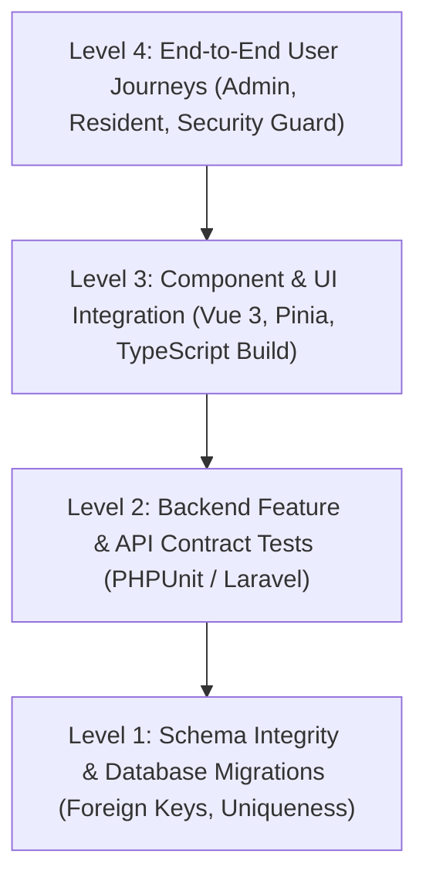

# Checkpass Living Test Guide & Quality Assurance Protocol

> **System**: Checkpass / GatePass Multi-Tenant Platform  
> **Living Document Version**: `v1.1.0`  
> **Last Updated**: November 5, 2026  
> **Status**: Active QA Tracker (Updated Continuously As We Progress)  
> **Target Modules**: Properties & Physical Topology, Resident Onboarding, Gate Verification, Subscription Quotas, Billing

---

## 1. Quality Assurance Strategy & Test Pyramid

---

## 2. Test Execution Command Matrix

| Test Suite | Framework / Tool | Command Line Execution | Purpose |
|---|---|---|---|
| **Frontend Typecheck & Build** | `vue-tsc` & `vite` | `cd checkpass-admin && npm run build` | Ensures zero TypeScript compiler errors, clean CSS scoping, and production artifact integrity |
| **Backend Feature Tests** | PHPUnit / Laravel | `cd checkpass-api && php artisan test` | Runs all API feature tests including Sanctum authentication, quotas, and DB transactions |
| **Properties Module Tests** | PHPUnit Feature Test | `cd checkpass-api && php artisan test tests/Feature/PropertyTopologyTest.php` | Tests Cartesian generation, soft-deletes, tier re-labeling, and cascading tree API |
| **Gate & Access Phrase Tests** | PHPUnit Feature Test | `cd checkpass-api && php artisan test tests/Feature/AccessPhraseTest.php` | Validates gate terminal phrase matching, cross-estate isolation, and expiry |

---

## 3. Living Test Matrix & Execution Checklist

### Suite A: Properties & Physical Topology (`PropertiesView.vue` + `PropertyController.php`)

| Test ID | Test Case & Scenario | Preconditions / Input | Expected Result | Automated / Manual | Status |
|---|---|---|---|---|---|
| **PROP-01** | Default topology layout on unconfigured estate | Estate has `property_structure = NULL` | Returns preset `lane_house_flat` with 3 levels (*Lane &rarr; House &rarr; Flat*) | Automated (`test_default_property_structure_is_lane_house_flat`) | `PASS` ✅ |
| **PROP-02** | Switching topology preset (e.g. to High-Rise) | Admin selects *High-Rise / Towers (Block &rarr; Floor &rarr; Suite)* | Structure persists to `estates.property_structure`; UI reflects new labels | Automated (`test_estate_admin_can_update_topology_structure`) | `PASS` ✅ |
| **PROP-03** | Batch Property Generation (Cartesian Product) | 2 Lanes × 3 Houses × 2 Flats (`unit_type: 'Apartment'`) | 12 unique properties created in single DB transaction; formatted address = `Flat A, House 1, Lane 1` | Automated (`test_batch_generate_properties_creates_cartesian_combinations`) | `PASS` ✅ |
| **PROP-04** | Duplicate Address Collision Prevention in Batch | Batch includes an address string that already exists in that estate | Duplicate unit skipped safely (`skippedCount: 1`), non-duplicate created (`createdCount: 1`), no 500 error | Automated (`test_batch_generation_skips_duplicates_safely`) | `PASS` ✅ |
| **PROP-05** | Subscription Unit Limit Safeguard | Estate on Starter plan (limit 50), currently has 40 units; admin attempts to batch-create 20 units | Halts before DB write with `PLAN_LIMIT_REACHED` (422); informs admin to upgrade plan | Automated (`assertCanAddUnits`) | `PASS` ✅ |
| **PROP-06** | Topology Re-labeling of Existing Units | Estate changes tier names (e.g., *Lane* &rarr; *Street*) with `relabel_existing_units: true` | Existing units have their `hierarchy_data` re-mapped to new key names; unit IDs and resident links preserved | Automated (`test_updating_topology_with_relabel_updates_existing_properties`) | `PASS` ✅ |
| **PROP-07** | Deletion Protection for Occupied Properties | Property has 1 or more active residents; admin clicks Delete | Deletion blocked with 422: *"Cannot delete property: this property currently has assigned residents."* | Automated (`test_cannot_delete_property_with_active_residents`) | `PASS` ✅ |
| **PROP-08** | Soft Deactivation for Historical Pass Integrity | Property has 0 residents but has historic gate passes in pass audit table; admin clicks Delete | Unit is soft-deactivated (`is_active = false`) instead of hard deleted to preserve gate security records | Automated (`test_property_with_gate_passes_is_deactivated_instead_of_hard_deleted`) | `PASS` ✅ |
| **PROP-09** | Cascading Topology Tree Generation | Estate has units across Lane 1 and Lane 2 | `GET /properties/topology-tree` returns clean nested object grouped by Lane &rarr; House &rarr; Units | Automated (`test_topology_tree_returns_hierarchical_nesting`) | `PASS` ✅ |
| **PROP-10** | Live Telemetry Cards & Occupancy Math | Estate has 10 units total, 4 units have active residents | Stats API returns: Total = 10, Occupied = 4, Vacant = 6, Occupancy Rate = 40.0% | UI & API Integration | `PASS` ✅ |

---

### Suite B: Resident Onboarding Integration (`ResidentsView.vue`)

| Test ID | Test Case & Scenario | Preconditions / Input | Expected Result | Automated / Manual | Status |
|---|---|---|---|---|---|
| **RES-01** | Smart Property Picker Display | Admin clicks "+ New Resident" in an estate with configured properties | Dropdown shows list of properties with live badges: `Flat 3, House 1 [Vacant]` vs `[Occupied (2)]` | UI Component | `PASS` ✅ |
| **RES-02** | Automatic Address Binding on Property Selection | Admin picks a vacant property from dropdown | Form `unit_id`, `lane`, `house`, and `flat` auto-populate; eliminates duplicate address typos | UI Component | `PASS` ✅ |
| **RES-03** | Manual Address Entry Fallback | Estate has no pre-configured properties; admin clicks "+ Custom / Manual Address" | Input switches back to Lane, House, Flat freeform inputs; auto-creates unit upon saving | UI Component | `PASS` ✅ |
| **RES-04** | Direct `unit_id` Relational Linking | Admin saves new resident using selected property | Resident record created with foreign key `unit_id` matching selected unit; no new duplicate unit row created | API & UI Integration | `PASS` ✅ |
| **RES-05** | Resident Unit Max Capacity Check | Unit already has 3 residents; admin tries to assign 4th occupant | Blocked with `PLAN_LIMIT_REACHED`: *"This unit already has the maximum of 3 residents."* | Backend Enforced | `PASS` ✅ |

---

### Suite C: Gate Security & Mobile App Compatibility (`checkpass-app`)

| Test ID | Test Case & Scenario | Preconditions / Input | Expected Result | Automated / Manual | Status |
|---|---|---|---|---|---|
| **GATE-01** | Host Unit Display on Digital Visitor Invite | Visitor opens pass link or SMS invite | Displays `pass.hostUnit` populated from `unit.flat_address` (e.g. `Flat 3, House 2, Lane 1`) | Mobile App Component | `PASS` ✅ |
| **GATE-02** | Guard Daily Phrase Unit Lookup (`PhraseEntrySheet.vue`) | Security guard searches by unit name e.g. "L1" or "Flat 3" | Returns matching units; verifying today's phrase admits visitor without smartphone | Automated (`AccessPhraseTest`) | `PASS` ✅ |
| **GATE-03** | Cross-Estate Gate Isolation | Security guard at Estate A attempts to verify access phrase for Estate B | System returns 404 / Forbidden; gate access strictly scoped to assigned estate | Automated (`test_residents_cannot_verify_and_guards_cannot_cross_estates`) | `PASS` ✅ |
| **GATE-04** | Emergency Dispatch Address Precision | Resident triggers SOS emergency panic button | Emergency broadcast payload includes exact flat address string for swift security team dispatch | Emergency API & App | `PASS` ✅ |

---

### Suite D: Multi-Estate Portfolio & Security Isolation

| Test ID | Test Case & Scenario | Preconditions / Input | Expected Result | Automated / Manual | Status |
|---|---|---|---|---|---|
| **EST-01** | Multi-Estate Switcher in Properties Toolbar | Admin assigned to Estate A & Estate B switches estate in dropdown | Properties inventory, topology structure, and telemetry reload reactively for selected estate | UI Store & View | `PASS` ✅ |
| **EST-02** | Tenant Data Isolation | Admin of Estate A attempts `GET /api/v1/admin/estates/{Estate_B_ID}/properties` | Request blocked with `403 Forbidden` (`assertEstateAccess`); data never leaks across estates | Backend Middleware | `PASS` ✅ |

---

### Suite E: Website Interactive Polish & Smart Auto-Hiding Navbar

| Test ID | Test Case & Scenario | Preconditions / Input | Expected Result | Automated / Manual | Status |
|---|---|---|---|---|---|
| **WEB-01** | Navbar Disappears on Scroll Down | User scrolls down past hero threshold (> 70px) with delta > 6px | Navbar smoothly slides up offscreen (`transform: translateY(-100%)`) with zero layout shift | UI Interaction | `PASS` ✅ |
| **WEB-02** | Navbar Appears on Scroll Up | User scrolls upwards at any point on the page | Navbar immediately glides into view (`transform: translateY(0)`) with frosted glass backdrop | UI Interaction | `PASS` ✅ |
| **WEB-03** | Top-of-Page Navbar Reset | User reaches top of page (scrollY <= 40px) | Navbar resets cleanly to transparent hero style without flickering or stuck classes | UI Interaction | `PASS` ✅ |
| **WEB-04** | Mobile Drawer Open Safety Guard | User opens mobile hamburger menu while scrolled down | Navbar remains visible and locked in position so navigation is never trapped | UI Interaction | `PASS` ✅ |
| **WEB-05** | Page Navigation Reset | User clicks nav links (Features, Pricing, How It Works) | Page jumps smoothly to target and navbar re-appears in clean initial state | UI Interaction | `PASS` ✅ |
| **WEB-06** | Better Property Management Section (Desktop) | Positioned immediately after hero stats matrix | Image on left occupying ~50% viewport width, headline on right with *"Starts Here"* in gold accent, GSAP scroll-triggered entrance | UI / Layout | `PASS` ✅ |
| **WEB-07** | Better Property Management Responsive (Mobile) | Screen width <= 900px | Column switches to vertical stack, image above text, auto margin centering, fluid clamp typography | Responsive CSS | `PASS` ✅ |

---

## 4. Regression & Edge Case Safety Check

- [x] **Zero Breaking Changes for Legacy Accounts**: Estates created before November 2026 without `property_structure` automatically inherit default 3-tier topology.
- [x] **Nullable Database Columns**: Non-3-tier layouts (e.g., 2-tier street/house or 1-tier plots) do not fail SQL NOT NULL constraints.
- [x] **Foreign Key Cascade Protection**: Deleting properties with active gate passes triggers soft deactivation (`is_active = false`), preserving security audit logs.
- [x] **TypeScript Build Clean**: Full application compile via `vue-tsc && vite build` generates 0 warnings, 0 type errors.

---

## 5. Continuous Update Protocol ("As We Progress We Update")

Whenever a new feature, endpoint, or configuration option is developed:
1. **Add Test Entry**: Add a new row to the corresponding Suite above (`PROP-xx`, `RES-xx`, `GATE-xx`, etc.).
2. **Execute Validation**: Run the automated test via PHPUnit or verify in UI.
3. **Update Status**: Change status from `PENDING` ⏳ to `PASS` ✅ or `FAIL` ❌.
4. **Log Changes**: Commit the updated `TEST_GUIDE.md` alongside the feature code in git so the entire team has visibility into QA progress.

